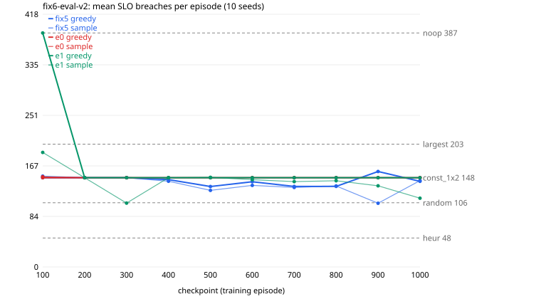

# fix6-eval-v2

Generated 2026-11-11T14:11:47 by `tools/counselctl.py run`. All numbers below are measured, from `episodes.jsonl` in this folder.

## Setup

- Conditions: SLO 150, freq 6666, budget [2500, 3600], overrun 0.2, knob 0.05, flavors 5, chain 3
- Seeds: 1000-1009 (10); modes: greedy, sample; workers: 4
- Eval code: `83a5ce0` (fix6-10-g83a5ce0); image `sha256:2fa7ed7e051d`
- Episodes: 650 done, 0 failed

## Models

| label | source | checkpoints | trained on | note |
|---|---|---|---|---|
| fix5 | `a3c/t113-fix5-f5-c3` | 100, 200, 300, 400, 500, 600, 700, 800, 900, 1000 | SLO 150, freq 6666, budget [2500, 3600] |  |
| e0 | `a3c/t113-fix6-f5-c3-ent0` | 100, 200, 300, 400, 500, 600, 700, 800, 900, 1000 | SLO 150, freq 6666, budget [2500, 3600] |  |
| e1 | `a3c/t113-fix6-f5-c3-ent001` | 100, 200, 300, 400, 500, 600, 700, 800, 900, 1000 | SLO 150, freq 6666, budget [2500, 3600] |  |

## Results (sorted by mean breaches; lower is better)

| arm | n | breaches | 95% CI | reward/step | applied | util | overrun steps | note |
|---|---|---|---|---|---|---|---|---|
| heur | 10 | 47.9 | ±11.5 | 1.543 | 32.8 | 0.591 | 0.0 | baseline |
| fix5_m900_s | 10 | 105.4 | ±15.9 | 1.463 | 82.0 | 0.645 | 0.0 |  |
| e1_m300_s | 10 | 105.7 | ±23.8 | 1.460 | 64.4 | 0.692 | 0.0 |  |
| random | 10 | 106.3 | ±20.8 | 1.473 | 86.9 | 0.646 | 0.0 | baseline |
| e1_m1000_s | 10 | 113.8 | ±15.6 | 1.498 | 63.7 | 0.679 | 0.0 |  |
| fix5_m500_s | 10 | 126.8 | ±11.6 | 1.439 | 72.1 | 0.692 | 0.0 |  |
| fix5_m700_s | 10 | 131.6 | ±20.0 | 1.496 | 75.3 | 0.710 | 0.0 |  |
| fix5_m500_g | 10 | 133.1 | ±14.6 | 1.427 | 77.1 | 0.707 | 0.0 |  |
| fix5_m700_g | 10 | 133.3 | ±22.6 | 1.484 | 75.2 | 0.707 | 0.0 |  |
| fix5_m800_g | 10 | 133.4 | ±22.4 | 1.484 | 75.4 | 0.708 | 0.0 |  |
| fix5_m800_s | 10 | 134.1 | ±21.9 | 1.475 | 77.5 | 0.706 | 0.0 |  |
| e1_m900_s | 10 | 134.3 | ±15.9 | 1.421 | 80.0 | 0.716 | 0.0 |  |
| fix5_m600_s | 10 | 135.0 | ±15.9 | 1.450 | 79.6 | 0.707 | 0.0 |  |
| fix5_m600_g | 10 | 141.0 | ±15.6 | 1.427 | 81.8 | 0.726 | 0.0 |  |
| e1_m700_s | 10 | 141.3 | ±19.8 | 1.389 | 88.0 | 0.726 | 0.0 |  |
| fix5_m1000_g | 10 | 141.8 | ±16.4 | 1.402 | 82.2 | 0.722 | 0.0 |  |
| fix5_m400_s | 10 | 141.9 | ±17.7 | 1.437 | 82.6 | 0.729 | 0.0 |  |
| e1_m800_s | 10 | 142.7 | ±17.3 | 1.404 | 83.2 | 0.725 | 0.0 |  |
| fix5_m1000_s | 10 | 142.9 | ±9.5 | 1.429 | 88.1 | 0.711 | 0.0 |  |
| e1_m600_s | 10 | 144.4 | ±20.3 | 1.384 | 87.5 | 0.733 | 0.0 |  |
| fix5_m400_g | 10 | 144.6 | ±18.9 | 1.407 | 86.8 | 0.732 | 0.0 |  |
| const_1x2 | 10 | 147.7 | ±22.4 | 1.378 | 90.2 | 0.738 | 0.0 | baseline |
| fix5_m100_g | 10 | 147.7 | ±22.4 | 1.378 | 90.2 | 0.738 | 0.0 | = const_1x2 on every seed |
| fix5_m200_g | 10 | 147.7 | ±22.4 | 1.378 | 90.2 | 0.738 | 0.0 | = const_1x2 on every seed |
| fix5_m300_g | 10 | 147.7 | ±22.4 | 1.378 | 90.2 | 0.738 | 0.0 | = const_1x2 on every seed |
| fix5_m200_s | 10 | 147.7 | ±22.4 | 1.378 | 90.2 | 0.738 | 0.0 | = const_1x2 on every seed |
| fix5_m300_s | 10 | 147.7 | ±22.4 | 1.378 | 90.2 | 0.738 | 0.0 | = const_1x2 on every seed |
| e0_m100_g | 10 | 147.7 | ±22.4 | 1.378 | 90.2 | 0.738 | 0.0 | = const_1x2 on every seed |
| e0_m200_s | 10 | 147.7 | ±22.4 | 1.378 | 90.2 | 0.738 | 0.0 | = const_1x2 on every seed |
| e0_m200_g | 10 | 147.7 | ±22.4 | 1.378 | 90.2 | 0.738 | 0.0 | = const_1x2 on every seed |
| e0_m300_g | 10 | 147.7 | ±22.4 | 1.378 | 90.2 | 0.738 | 0.0 | = const_1x2 on every seed |
| e0_m400_g | 10 | 147.7 | ±22.4 | 1.378 | 90.2 | 0.738 | 0.0 | = const_1x2 on every seed |
| e0_m300_s | 10 | 147.7 | ±22.4 | 1.378 | 90.2 | 0.738 | 0.0 | = const_1x2 on every seed |
| e0_m400_s | 10 | 147.7 | ±22.4 | 1.378 | 90.2 | 0.738 | 0.0 | = const_1x2 on every seed |
| e0_m500_g | 10 | 147.7 | ±22.4 | 1.378 | 90.2 | 0.738 | 0.0 | = const_1x2 on every seed |
| e0_m500_s | 10 | 147.7 | ±22.4 | 1.378 | 90.2 | 0.738 | 0.0 | = const_1x2 on every seed |
| e0_m600_g | 10 | 147.7 | ±22.4 | 1.378 | 90.2 | 0.738 | 0.0 | = const_1x2 on every seed |
| e0_m600_s | 10 | 147.7 | ±22.4 | 1.378 | 90.2 | 0.738 | 0.0 | = const_1x2 on every seed |
| e0_m700_g | 10 | 147.7 | ±22.4 | 1.378 | 90.2 | 0.738 | 0.0 | = const_1x2 on every seed |
| e0_m700_s | 10 | 147.7 | ±22.4 | 1.378 | 90.2 | 0.738 | 0.0 | = const_1x2 on every seed |
| e0_m800_g | 10 | 147.7 | ±22.4 | 1.378 | 90.2 | 0.738 | 0.0 | = const_1x2 on every seed |
| e0_m800_s | 10 | 147.7 | ±22.4 | 1.378 | 90.2 | 0.738 | 0.0 | = const_1x2 on every seed |
| e0_m900_g | 10 | 147.7 | ±22.4 | 1.378 | 90.2 | 0.738 | 0.0 | = const_1x2 on every seed |
| e0_m900_s | 10 | 147.7 | ±22.4 | 1.378 | 90.2 | 0.738 | 0.0 | = const_1x2 on every seed |
| e0_m1000_g | 10 | 147.7 | ±22.4 | 1.378 | 90.2 | 0.738 | 0.0 | = const_1x2 on every seed |
| e0_m1000_s | 10 | 147.7 | ±22.4 | 1.378 | 90.2 | 0.738 | 0.0 | = const_1x2 on every seed |
| e1_m200_g | 10 | 147.7 | ±22.4 | 1.378 | 90.2 | 0.738 | 0.0 | = const_1x2 on every seed |
| e1_m200_s | 10 | 147.7 | ±22.4 | 1.378 | 90.2 | 0.738 | 0.0 |  |
| e1_m300_g | 10 | 147.7 | ±22.4 | 1.378 | 90.2 | 0.738 | 0.0 | = const_1x2 on every seed |
| e1_m400_g | 10 | 147.7 | ±22.4 | 1.378 | 90.2 | 0.738 | 0.0 | = const_1x2 on every seed |
| e1_m400_s | 10 | 147.7 | ±22.4 | 1.378 | 90.2 | 0.738 | 0.0 | = const_1x2 on every seed |
| e1_m500_g | 10 | 147.7 | ±22.4 | 1.378 | 90.2 | 0.738 | 0.0 | = const_1x2 on every seed |
| e1_m600_g | 10 | 147.7 | ±22.4 | 1.378 | 90.2 | 0.738 | 0.0 | = const_1x2 on every seed |
| e1_m700_g | 10 | 147.7 | ±22.4 | 1.378 | 90.2 | 0.738 | 0.0 | = const_1x2 on every seed |
| e1_m800_g | 10 | 147.7 | ±22.4 | 1.378 | 90.2 | 0.738 | 0.0 | = const_1x2 on every seed |
| e1_m900_g | 10 | 147.7 | ±22.4 | 1.378 | 90.2 | 0.738 | 0.0 | = const_1x2 on every seed |
| e1_m1000_g | 10 | 147.7 | ±22.4 | 1.378 | 90.2 | 0.738 | 0.0 | = const_1x2 on every seed |
| e1_m500_s | 10 | 148.4 | ±22.2 | 1.376 | 91.4 | 0.738 | 0.0 |  |
| e0_m100_s | 10 | 149.3 | ±22.1 | 1.375 | 90.7 | 0.739 | 0.0 |  |
| fix5_m100_s | 10 | 150.3 | ±19.8 | 1.370 | 95.1 | 0.735 | 0.0 |  |
| fix5_m900_g | 10 | 158.0 | ±38.3 | 1.325 | 170.3 | 0.655 | 0.0 |  |
| e1_m100_s | 10 | 189.6 | ±28.7 | 1.264 | 45.7 | 0.758 | 0.0 |  |
| largest | 10 | 203.3 | ±48.4 | 1.119 | 261.0 | 0.615 | 0.0 | baseline |
| noop | 10 | 387.3 | ±97.4 | 0.744 | 0.0 | 0.921 | 0.0 | baseline |
| e1_m100_g | 10 | 387.3 | ±97.4 | 0.744 | 0.3 | 0.921 | 0.0 |  |

CI = 95% t-interval of the mean over seeds. `= X on every seed` means breaches, actions applied, and mean CPU/memory match baseline X exactly on every seed: in practice the same policy.

## Paired comparison vs reference arms

Same seeds, so each difference is on the same load trace. diff = arm minus reference (negative = fewer breaches). `*` = 95% interval excludes 0. W/T/L = seeds where the arm had fewer / equal / more breaches. No correction for the number of comparisons.

| arm | vs random | vs heur |
|---|---|---|
| fix5_m900_s | -0.9 [-23.0, +21.2] 5/1/4 | +57.5 [+34.2, +80.8] * 0/1/9 |
| e1_m300_s | -0.6 [-34.7, +33.5] 6/0/4 | +57.8 [+27.7, +87.9] * 1/0/9 |
| e1_m1000_s | +7.5 [-7.4, +22.4] 3/0/7 | +65.9 [+48.3, +83.5] * 0/0/10 |
| fix5_m500_s | +20.5 [-2.6, +43.6] 3/0/7 | +78.9 [+57.0, +100.8] * 0/1/9 |
| fix5_m700_s | +25.3 [-5.0, +55.6] 4/0/6 | +83.7 [+56.2, +111.2] * 0/1/9 |
| fix5_m500_g | +26.8 [+0.7, +52.9] * 3/0/7 | +85.2 [+60.8, +109.6] * 0/1/9 |
| fix5_m700_g | +27.0 [-5.0, +59.0] 4/0/6 | +85.4 [+55.9, +114.9] * 0/1/9 |
| fix5_m800_g | +27.1 [-4.8, +59.0] 4/0/6 | +85.5 [+56.1, +114.9] * 0/1/9 |
| fix5_m800_s | +27.8 [-4.4, +60.0] 4/0/6 | +86.2 [+57.2, +115.2] * 0/1/9 |
| e1_m900_s | +28.0 [-0.1, +56.1] 3/0/7 | +86.4 [+61.5, +111.3] * 0/1/9 |
| fix5_m600_s | +28.7 [-1.0, +58.4] 3/0/7 | +87.1 [+62.2, +112.0] * 0/1/9 |
| fix5_m600_g | +34.7 [+3.4, +66.0] * 3/0/7 | +93.1 [+67.9, +118.3] * 0/1/9 |
| e1_m700_s | +35.0 [+1.6, +68.4] * 3/0/7 | +93.4 [+65.6, +121.2] * 0/1/9 |
| fix5_m1000_g | +35.5 [+3.6, +67.4] * 3/0/7 | +93.9 [+68.1, +119.7] * 0/1/9 |
| fix5_m400_s | +35.6 [+4.1, +67.1] * 3/0/7 | +94.0 [+67.4, +120.6] * 0/1/9 |
| e1_m800_s | +36.4 [+3.6, +69.2] * 3/0/7 | +94.8 [+68.2, +121.4] * 0/1/9 |
| fix5_m1000_s | +36.6 [+18.1, +55.1] * 1/0/9 | +95.0 [+86.5, +103.5] * 0/0/10 |
| e1_m600_s | +38.1 [+2.5, +73.7] * 3/0/7 | +96.5 [+67.7, +125.3] * 0/1/9 |
| fix5_m400_g | +38.3 [+5.1, +71.5] * 3/0/7 | +96.7 [+69.0, +124.4] * 0/1/9 |
| const_1x2 | +41.4 [+4.9, +77.9] * 3/0/7 | +99.8 [+69.3, +130.3] * 0/1/9 |
| fix5_m100_g | +41.4 [+4.9, +77.9] * 3/0/7 | +99.8 [+69.3, +130.3] * 0/1/9 |
| fix5_m200_g | +41.4 [+4.9, +77.9] * 3/0/7 | +99.8 [+69.3, +130.3] * 0/1/9 |
| fix5_m300_g | +41.4 [+4.9, +77.9] * 3/0/7 | +99.8 [+69.3, +130.3] * 0/1/9 |
| fix5_m200_s | +41.4 [+4.9, +77.9] * 3/0/7 | +99.8 [+69.3, +130.3] * 0/1/9 |
| fix5_m300_s | +41.4 [+4.9, +77.9] * 3/0/7 | +99.8 [+69.3, +130.3] * 0/1/9 |
| e0_m100_g | +41.4 [+4.9, +77.9] * 3/0/7 | +99.8 [+69.3, +130.3] * 0/1/9 |
| e0_m200_s | +41.4 [+4.9, +77.9] * 3/0/7 | +99.8 [+69.3, +130.3] * 0/1/9 |
| e0_m200_g | +41.4 [+4.9, +77.9] * 3/0/7 | +99.8 [+69.3, +130.3] * 0/1/9 |
| e0_m300_g | +41.4 [+4.9, +77.9] * 3/0/7 | +99.8 [+69.3, +130.3] * 0/1/9 |
| e0_m400_g | +41.4 [+4.9, +77.9] * 3/0/7 | +99.8 [+69.3, +130.3] * 0/1/9 |
| e0_m300_s | +41.4 [+4.9, +77.9] * 3/0/7 | +99.8 [+69.3, +130.3] * 0/1/9 |
| e0_m400_s | +41.4 [+4.9, +77.9] * 3/0/7 | +99.8 [+69.3, +130.3] * 0/1/9 |
| e0_m500_g | +41.4 [+4.9, +77.9] * 3/0/7 | +99.8 [+69.3, +130.3] * 0/1/9 |
| e0_m500_s | +41.4 [+4.9, +77.9] * 3/0/7 | +99.8 [+69.3, +130.3] * 0/1/9 |
| e0_m600_g | +41.4 [+4.9, +77.9] * 3/0/7 | +99.8 [+69.3, +130.3] * 0/1/9 |
| e0_m600_s | +41.4 [+4.9, +77.9] * 3/0/7 | +99.8 [+69.3, +130.3] * 0/1/9 |
| e0_m700_g | +41.4 [+4.9, +77.9] * 3/0/7 | +99.8 [+69.3, +130.3] * 0/1/9 |
| e0_m700_s | +41.4 [+4.9, +77.9] * 3/0/7 | +99.8 [+69.3, +130.3] * 0/1/9 |
| e0_m800_g | +41.4 [+4.9, +77.9] * 3/0/7 | +99.8 [+69.3, +130.3] * 0/1/9 |
| e0_m800_s | +41.4 [+4.9, +77.9] * 3/0/7 | +99.8 [+69.3, +130.3] * 0/1/9 |
| e0_m900_g | +41.4 [+4.9, +77.9] * 3/0/7 | +99.8 [+69.3, +130.3] * 0/1/9 |
| e0_m900_s | +41.4 [+4.9, +77.9] * 3/0/7 | +99.8 [+69.3, +130.3] * 0/1/9 |
| e0_m1000_g | +41.4 [+4.9, +77.9] * 3/0/7 | +99.8 [+69.3, +130.3] * 0/1/9 |
| e0_m1000_s | +41.4 [+4.9, +77.9] * 3/0/7 | +99.8 [+69.3, +130.3] * 0/1/9 |
| e1_m200_g | +41.4 [+4.9, +77.9] * 3/0/7 | +99.8 [+69.3, +130.3] * 0/1/9 |
| e1_m200_s | +41.4 [+4.9, +77.9] * 3/0/7 | +99.8 [+69.3, +130.3] * 0/1/9 |
| e1_m300_g | +41.4 [+4.9, +77.9] * 3/0/7 | +99.8 [+69.3, +130.3] * 0/1/9 |
| e1_m400_g | +41.4 [+4.9, +77.9] * 3/0/7 | +99.8 [+69.3, +130.3] * 0/1/9 |
| e1_m400_s | +41.4 [+4.9, +77.9] * 3/0/7 | +99.8 [+69.3, +130.3] * 0/1/9 |
| e1_m500_g | +41.4 [+4.9, +77.9] * 3/0/7 | +99.8 [+69.3, +130.3] * 0/1/9 |
| e1_m600_g | +41.4 [+4.9, +77.9] * 3/0/7 | +99.8 [+69.3, +130.3] * 0/1/9 |
| e1_m700_g | +41.4 [+4.9, +77.9] * 3/0/7 | +99.8 [+69.3, +130.3] * 0/1/9 |
| e1_m800_g | +41.4 [+4.9, +77.9] * 3/0/7 | +99.8 [+69.3, +130.3] * 0/1/9 |
| e1_m900_g | +41.4 [+4.9, +77.9] * 3/0/7 | +99.8 [+69.3, +130.3] * 0/1/9 |
| e1_m1000_g | +41.4 [+4.9, +77.9] * 3/0/7 | +99.8 [+69.3, +130.3] * 0/1/9 |
| e1_m500_s | +42.1 [+6.3, +77.9] * 3/0/7 | +100.5 [+70.2, +130.8] * 0/1/9 |
| e0_m100_s | +43.0 [+7.1, +78.9] * 3/0/7 | +101.4 [+71.2, +131.6] * 0/1/9 |
| fix5_m100_s | +44.0 [+11.6, +76.4] * 2/0/8 | +102.4 [+74.9, +129.9] * 0/0/10 |
| fix5_m900_g | +51.7 [+6.9, +96.5] * 2/0/8 | +110.1 [+64.1, +156.1] * 0/1/9 |
| e1_m100_s | +83.3 [+41.5, +125.1] * 1/0/9 | +141.7 [+103.3, +180.1] * 0/0/10 |
| largest | +97.0 [+45.8, +148.2] * 2/0/8 | +155.4 [+100.6, +210.2] * 0/0/10 |
| noop | +281.0 [+173.0, +389.0] * 0/0/10 | +339.4 [+234.1, +444.7] * 0/0/10 |
| e1_m100_g | +281.0 [+173.0, +389.0] * 0/0/10 | +339.4 [+234.1, +444.7] * 0/0/10 |

## Automatic notes

- 34 of 60 checkpoint arms behave exactly like a baseline on every seed: fix5_m100_g = const_1x2, fix5_m200_g = const_1x2, fix5_m300_g = const_1x2, fix5_m200_s = const_1x2, fix5_m300_s = const_1x2, e0_m100_g = const_1x2, e0_m200_s = const_1x2, e0_m200_g = const_1x2, e0_m300_g = const_1x2, e0_m400_g = const_1x2, e0_m300_s = const_1x2, e0_m400_s = const_1x2 ...
- Best checkpoint arm: fix5_m900_s, 105.4 breaches (best baseline: heur)
- No arm ever exceeded the budget (overrun steps 0 everywhere): budget [2500, 3600] does not bind under these conditions.

## Breaches per checkpoint



## Provenance

```
{
 "created": "2026-11-11T14:07:17",
 "host": "Jeeva-Victus",
 "eval_commit": "83a5ce0a09da261bd322082583c69fed9d1cfe4a",
 "tool_describe": "fix6-10-g83a5ce0",
 "counselctl_sha256": "322ecb9a5c31d9be10bd4bbe10225dd16c3dbf30e6cf3c647a56e7c1378ee508",
 "image": "counsel:t113",
 "image_id": "sha256:2fa7ed7e051dfde5ec82d268a5cd806c960ae819013db4f150f5569035634dbc",
 "checkpoint_sha256": {
  "fix5/model100.pt": "c4c53ce7e4938b8274dd5413b9687042a3b1ffc0b763c109935b82281dd4f85b",
  "fix5/model200.pt": "e7b3237718d4c24d108e52eaa241099f26899515754627bc95f28325cd6064d5",
  "fix5/model300.pt": "314c0625df4dfe2f2674e5866d70e848410902e3fb7ec56ee26c88ed6b6e56f2",
  "fix5/model400.pt": "4b2b0cced5511d270b5d3054165dae9970f10ec7f2783b64638c91596008607c",
  "fix5/model500.pt": "f8af41d096f5b964af152a46b13bcd67ee30d3000c9bdc2ab1870f5d2df8ddfd",
  "fix5/model600.pt": "41e71f3d6b20c0c8f6ab89086808a738c1604570ec38722a111d44fd0f4ae797",
  "fix5/model700.pt": "003c436c3a633acf69b4d48d0d7cccd90c2f130a982fd51abc313119f20f79ae",
  "fix5/model800.pt": "2ba0716aac8ace70e7d4e09ee0d0f6c27b17024552a20e58c86c169a826487c5",
  "fix5/model900.pt": "734c6e6efe789200a050446ed9a9679c7fc9b4f4169030d0766bc094bb15a183",
  "fix5/model1000.pt": "feab71c63f2e00198710988f1fa79177113e7a8df8669dfd3c209556025456af",
  "e0/model100.pt": "e0235457d1c37eae271f74611e17fb056224518f7434678901be1f3f8d9cc65d",
  "e0/model200.pt": "cbcaab3db93447bac504e8496c64f8e5749118bd6471a05bfde736bf8c66e9b7",
  "e0/model300.pt": "13a27fe0c75451590cecd59e99c2d22256479e95ded5c95a14544c1f262490bf",
  "e0/model400.pt": "16a3ed7d43654b21467d9051d13e3cd047734bad7dee76ecfa800ab20f400bea",
  "e0/model500.pt": "8a01b044ed1096db74a7155dd55fd426c0b62f0465607655b3433a48df02201f",
  "e0/model600.pt": "9d250beb97b915c8901e466712a9d988b3481aaca462782eee4e328fd391bb03",
  "e0/model700.pt": "c82039f4f719cc8cd7cd3b124c94c0ccb594e5de949341b8b3965e5f1155344f",
  "e0/model800.pt": "8712febe95342d8e20ec752b89cc839555d1378c61f1948e344617e220315024",
  "e0/model900.pt": "92b6cc6cc88925f46b99bbe7355e30864c6a99e28e16e64c22fcae941a1e73c2",
  "e0/model1000.pt": "cf21ed73002a424c81e43ca4a40b420e5613ca1111ac409f040a92cd136f6504",
  "e1/model100.pt": "641af2f9f826d9e24c7a39bfd970592e256bebc21024294998c31fe7b30c35c3",
  "e1/model200.pt": "3084b6535ad46cb9733cc1e82ab63f6da1301c3b5af6cea2fc9a848f352ca631",
  "e1/model300.pt": "f7235f80af37a8a29a2d48ece33f023bfa1b12472dbf798df13769a91695464f",
  "e1/model400.pt": "c17c1031332c64f6d1c30e5177309de852f40d4af31bf7c3962c4346bf630df3",
  "e1/model500.pt": "a5eb329b1df3c138700d33d11a471dbde7872533a887f949b4e56fbb70f7784a",
  "e1/model600.pt": "d0c2ce19802894a9f655b5d541abb3541736ae04046172b59e9681f3847f412e",
  "e1/model700.pt": "5a33b6a893eae444408bc2d74eef32a9c414738f5190fc1c0dbe4d2300a4d02a",
  "e1/model800.pt": "ea884caf87d7a5055a624bb6ee519707387493623d7fc19326f3cc0f5a40e580",
  "e1/model900.pt": "3c286a711c7421d224960d52767fe267f33029c50aeb7054e7b3e1d1ee25c582",
  "e1/model1000.pt": "eb4e593cad87214f2681fc4c6c0362a71f82a8e1f6bbbd4a52d6cb025f8350d5"
 }
}
```
Full `pip freeze` of the image is in `provenance.json`.
