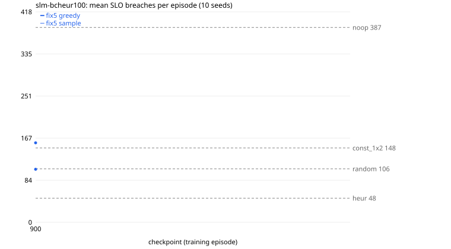

# slm-bcheur100

Generated 2026-11-11T20:35:18 by `tools/counselctl.py run`. All numbers below are measured, from `episodes.jsonl` in this folder.

## Setup

- Conditions: SLO 150, freq 6666, budget [2500, 3600], overrun 0.2, knob 0.05, flavors 5, chain 3
- Seeds: 1000-1009 (10); modes: greedy, sample; workers: 4
- Eval code: `7388aaf` (fix6-18-g7388aaf); image `sha256:2fa7ed7e051d`
- Episodes: 70 done, 0 failed

## Models

| label | source | checkpoints | trained on | note |
|---|---|---|---|---|
| fix5 | `a3c/t113-fix5-f5-c3` | 900 | SLO 150, freq 6666, budget [2500, 3600] |  |

## Results (sorted by mean breaches; lower is better)

| arm | n | failed | breaches | 95% CI | reward/step | applied | util | overrun steps | note |
|---|---|---|---|---|---|---|---|---|---|
| slm_bcheur | 10 | 0 | 40.7 | ±7.0 | 1.505 | 29.1 | 0.573 | 0.0 |  |
| heur | 10 | 0 | 47.9 | ±11.5 | 1.543 | 32.8 | 0.591 | 0.0 | baseline |
| fix5_m900_s | 10 | 0 | 105.4 | ±15.9 | 1.463 | 82.0 | 0.645 | 0.0 |  |
| random | 10 | 0 | 106.3 | ±20.8 | 1.473 | 86.9 | 0.646 | 0.0 | baseline |
| const_1x2 | 10 | 0 | 147.7 | ±22.4 | 1.378 | 90.2 | 0.738 | 0.0 | baseline |
| fix5_m900_g | 10 | 0 | 158.0 | ±38.3 | 1.325 | 170.3 | 0.655 | 0.0 |  |
| noop | 10 | 0 | 387.3 | ±97.4 | 0.744 | 0.0 | 0.921 | 0.0 | baseline |

CI = 95% t-interval of the mean over seeds. `= X on every seed` means breaches, actions applied, and mean CPU/memory match baseline X exactly on every seed: in practice the same policy.

## SLM arms (served by vLLM)

| arm | served model | queries/episode | invalid | errors | decision ms (mean / p95) |
|---|---|---|---|---|---|
| slm_bcheur | `bc-heur100-l1b-e2:operator` | 159.8 | 0.0% | 0.0% | 49 / 58 |

Invalid = the reply was not a listed option number; errors = the request failed. Both fall back to action 0 (no change). vLLM at temperature 0 is not guaranteed bit-exact across runs or batch sizes, so SLM rows can differ slightly on a re-run.

## Paired comparison vs reference arms

Same seeds, so each difference is on the same load trace. diff = arm minus reference (negative = fewer breaches). `*` = 95% interval excludes 0. W/T/L = seeds where the arm had fewer / equal / more breaches. No correction for the number of comparisons.

| arm | vs random | vs heur |
|---|---|---|
| slm_bcheur | -65.6 [-88.8, -42.4] * 10/0/0 | -7.2 [-23.2, +8.8] 2/8/0 |
| fix5_m900_s | -0.9 [-23.0, +21.2] 5/1/4 | +57.5 [+34.2, +80.8] * 0/1/9 |
| const_1x2 | +41.4 [+4.9, +77.9] * 3/0/7 | +99.8 [+69.3, +130.3] * 0/1/9 |
| fix5_m900_g | +51.7 [+6.9, +96.5] * 2/0/8 | +110.1 [+64.1, +156.1] * 0/1/9 |
| noop | +281.0 [+173.0, +389.0] * 0/0/10 | +339.4 [+234.1, +444.7] * 0/0/10 |

## Automatic notes

- Best checkpoint arm: slm_bcheur, 40.7 breaches (best baseline: heur)
- No arm ever exceeded the budget (overrun steps 0 everywhere): budget [2500, 3600] does not bind under these conditions.

## Breaches per checkpoint



## Provenance

```
{
 "created": "2026-11-11T20:34:28",
 "host": "Jeeva-Victus",
 "eval_commit": "7388aafeb5116b039979cca42a43c3dfb33d0fe8",
 "tool_describe": "fix6-18-g7388aaf",
 "counselctl_sha256": "858df2d950b2d6c77dc8143334a783ec20beb73c93b20ca533eaa85d1f0ebd92",
 "image": "counsel:t113",
 "image_id": "sha256:2fa7ed7e051dfde5ec82d268a5cd806c960ae819013db4f150f5569035634dbc",
 "checkpoint_sha256": {
  "fix5/model900.pt": "734c6e6efe789200a050446ed9a9679c7fc9b4f4169030d0766bc094bb15a183"
 },
 "vllm": {
  "base": "http://localhost:9000",
  "container_base": "http://host.docker.internal:9000",
  "served": [
   {
    "id": "bc-heur100-l1b-e2",
    "object": "model",
    "created": 1794409468,
    "owned_by": "vllm",
    "root": "/home/jeeva-san/Desktop/counsel-a3c-fresh/results/bc/heur100/models/l1b-e2/merged",
    "parent": null,
    "max_model_len": 2048,
    "permission": [
     {
      "id": "modelperm-9ddc19bfa27b8b21",
      "object": "model_permission",
      "created": 1794409468,
      "allow_create_engine": false,
      "allow_sampling": true,
      "allow_logprobs": true,
      "allow_search_indices": false,
      "allow_view": true,
      "allow_fine_tuning": false,
      "organization": "*",
      "group": null,
      "is_blocking": false
     }
    ]
   }
  ]
 }
}
```
Full `pip freeze` of the image is in `provenance.json`.
