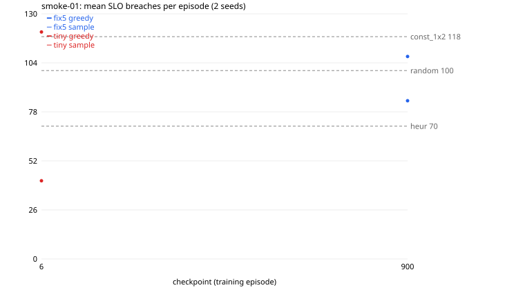

# smoke-01

Generated 2026-11-11T14:05:32 by `tools/counselctl.py run`. All numbers below are measured, from `episodes.jsonl` in this folder.

## Setup

- Conditions: SLO 150, freq 6666, budget [2500, 3600], overrun 0.2, knob 0.05, flavors 5, chain 3
- Seeds: 1000-1001 (2); modes: greedy, sample; workers: 2
- Eval code: `1e1d5b1` (fix6-9-g1e1d5b1-dirty); image `sha256:2fa7ed7e051d`
- Episodes: 14 done, 0 failed

## Models

| label | source | checkpoints | trained on | note |
|---|---|---|---|---|
| fix5 | `a3c/t113-fix5-f5-c3` | 900 | SLO 150, freq 6666, budget [2500, 3600] |  |
| tiny | trained here (fix6, ent 0.001) | 6 | SLO 150, freq 6666, budget [2500, 3600] | trained in this run (0:01:00, 1 ckpts) |

## Warnings

- uncommitted changes in tools/model/load-gen are NOT used (eval code comes from commit 1e1d5b1): ['M tools/counselctl.py']

## Results (sorted by mean breaches; lower is better)

| arm | n | breaches | 95% CI | reward/step | applied | util | overrun steps | note |
|---|---|---|---|---|---|---|---|---|
| tiny_m6_g | 2 | 41.5 | ±44.5 | 1.258 | 13.5 | 0.472 | 0.0 |  |
| heur | 2 | 70.5 | ±247.8 | 1.627 | 38.5 | 0.626 | 0.0 | baseline |
| fix5_m900_s | 2 | 84.0 | ±76.3 | 1.564 | 72.5 | 0.626 | 0.0 |  |
| random | 2 | 100.0 | ±330.5 | 1.529 | 98.0 | 0.623 | 0.0 | baseline |
| fix5_m900_g | 2 | 107.5 | ±222.4 | 1.457 | 111.0 | 0.629 | 0.0 |  |
| const_1x2 | 2 | 118.0 | ±355.9 | 1.512 | 74.5 | 0.692 | 0.0 | baseline |
| tiny_m6_s | 2 | 120.5 | ±425.8 | 1.512 | 88.0 | 0.640 | 0.0 |  |

CI = 95% t-interval of the mean over seeds. `= X on every seed` means breaches, actions applied, and mean CPU/memory match baseline X exactly on every seed: in practice the same policy.

## Paired comparison vs reference arms

Same seeds, so each difference is on the same load trace. diff = arm minus reference (negative = fewer breaches). `*` = 95% interval excludes 0. W/T/L = seeds where the arm had fewer / equal / more breaches. No correction for the number of comparisons.

| arm | vs random | vs heur |
|---|---|---|
| tiny_m6_g | -58.5 [-344.5, +227.5] 2/0/0 | -29.0 [-232.4, +174.4] 2/0/0 |
| fix5_m900_s | -16.0 [-270.2, +238.2] 1/0/1 | +13.5 [-158.1, +185.1] 0/1/1 |
| fix5_m900_g | +7.5 [-545.4, +560.4] 1/0/1 | +37.0 [-433.3, +507.3] 0/1/1 |
| const_1x2 | +18.0 [-668.3, +704.3] 1/0/1 | +47.5 [-556.2, +651.2] 0/1/1 |
| tiny_m6_s | +20.5 [-74.8, +115.8] 0/0/2 | +50.0 [-127.9, +227.9] 0/0/2 |

## Automatic notes

- Best checkpoint arm: tiny_m6_g, 41.5 breaches (best baseline: heur)
- No arm ever exceeded the budget (overrun steps 0 everywhere): budget [2500, 3600] does not bind under these conditions.

## Breaches per checkpoint



## Provenance

```
{
 "created": "2026-11-11T14:05:02",
 "host": "Jeeva-Victus",
 "eval_commit": "1e1d5b1ae9ef216dd0b51ac77f3443322d7bb4c2",
 "tool_describe": "fix6-9-g1e1d5b1-dirty",
 "counselctl_sha256": "322ecb9a5c31d9be10bd4bbe10225dd16c3dbf30e6cf3c647a56e7c1378ee508",
 "image": "counsel:t113",
 "image_id": "sha256:2fa7ed7e051dfde5ec82d268a5cd806c960ae819013db4f150f5569035634dbc",
 "checkpoint_sha256": {
  "fix5/model900.pt": "734c6e6efe789200a050446ed9a9679c7fc9b4f4169030d0766bc094bb15a183",
  "tiny/model6.pt": "b0cb4c2d60a955d63731f0f99c51b930c6319eca8a412e61f3ffb1fcb7705373"
 }
}
```
Full `pip freeze` of the image is in `provenance.json`.
