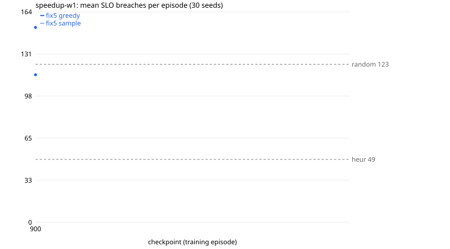

# speedup-w1

Generated 2026-11-12T02:28:23 by `tools/counselctl.py run`. All numbers below are measured, from `episodes.jsonl` in this folder.

## Setup

- Conditions: SLO 150, freq 6666, budget [2500, 3600], overrun 0.2, knob 0.05, flavors 5, chain 3
- Seeds: 1000-1029 (30); modes: greedy, sample; workers: 1
- Eval code: `d4e964f` (fix6-20-gd4e964f); image `sha256:2fa7ed7e051d`
- Episodes: 120 done, 0 failed

## Models

| label | source | checkpoints | trained on | note |
|---|---|---|---|---|
| fix5 | `a3c/t113-fix5-f5-c3` | 900 | SLO 150, freq 6666, budget [2500, 3600] |  |

## Results (sorted by mean breaches; lower is better)

| arm | n | failed | breaches | 95% CI | reward/step | applied | util | overrun steps | note |
|---|---|---|---|---|---|---|---|---|---|
| heur | 30 | 0 | 49.0 | ±7.5 | 1.547 | 35.0 | 0.583 | 0.0 | baseline |
| fix5_m900_s | 30 | 0 | 114.8 | ±13.5 | 1.471 | 91.0 | 0.640 | 0.0 |  |
| random | 30 | 0 | 122.9 | ±16.9 | 1.449 | 113.9 | 0.631 | 0.0 | baseline |
| fix5_m900_g | 30 | 0 | 151.6 | ±19.8 | 1.375 | 157.0 | 0.646 | 0.0 |  |

CI = 95% t-interval of the mean over seeds. `= X on every seed` means breaches, actions applied, and mean CPU/memory match baseline X exactly on every seed: in practice the same policy.

## Paired comparison vs reference arms

Same seeds, so each difference is on the same load trace. diff = arm minus reference (negative = fewer breaches). `*` = 95% interval excludes 0. W/T/L = seeds where the arm had fewer / equal / more breaches. No correction for the number of comparisons.

| arm | vs random |
|---|---|
| heur | -74.0 [-91.2, -56.7] * 30/0/0 |
| fix5_m900_s | -8.2 [-27.6, +11.3] 15/1/14 |
| fix5_m900_g | +28.6 [-0.2, +57.4] 8/0/22 |

## Automatic notes

- Best checkpoint arm: fix5_m900_s, 114.8 breaches (best baseline: heur)
- No arm ever exceeded the budget (overrun steps 0 everywhere): budget [2500, 3600] does not bind under these conditions.

## Breaches per checkpoint



## Provenance

```
{
 "created": "2026-11-12T02:26:26",
 "host": "Jeeva-Victus",
 "eval_commit": "d4e964f6875b7a05ad3f9160550820e13629b512",
 "tool_describe": "fix6-20-gd4e964f",
 "counselctl_sha256": "858df2d950b2d6c77dc8143334a783ec20beb73c93b20ca533eaa85d1f0ebd92",
 "image": "counsel:t113",
 "image_id": "sha256:2fa7ed7e051dfde5ec82d268a5cd806c960ae819013db4f150f5569035634dbc",
 "checkpoint_sha256": {
  "fix5/model900.pt": "734c6e6efe789200a050446ed9a9679c7fc9b4f4169030d0766bc094bb15a183"
 }
}
```
Full `pip freeze` of the image is in `provenance.json`.
